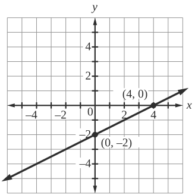
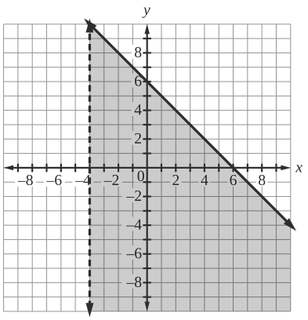
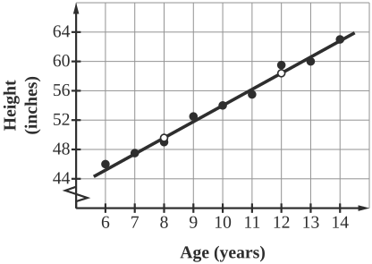
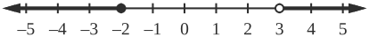
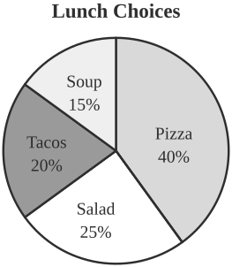
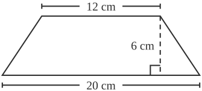

# Draw — the drawing kit

A picture from a short description of it. A spec (JSON) goes in and an SVG string comes out, drawn the way the state
draws the pictures of its tests: the same weights, arrowheads, ticks, dashes, greys and tints, the text set on the state's
face, a graph's numbers behind its plotted lines.

Croix, 15 Nov 2026, asked whether to copy the pictures of the state's released tests onto his site or draw them again:
*"I would rather redraw everything so we have the skills to do it. Because I'm going to want to build a bunch of banks and
generators. So probably better if we learn how to rebuild it exactly."* The kit was built doing that — 51 pictures of
FLDOE's released Grade 7 and Grade 8 FAST and Algebra 1 EOC tests, each laid over the state's own and matched to within
0.75 pt — and moved here on 16 Nov so that Cadence, the practice kit and the site draw with one hand
(*"yes move it to windmill"*). Nothing in it knows one test from another.

| A grid | A system of inequalities | A scatter plot |
|---|---|---|
|  |  |  |

| A number line | A circle graph | A shape |
|---|---|---|
|  |  |  |

Each of these is a file in `tests/`: the spec (`.json`) and the picture the kit drew of it (`.svg`).

## What is here

| Path | What it is |
|---|---|
| `draw.js` | **The kit.** `Draw.svg(spec, { alt })` → the SVG; `Draw.lay(spec)` → the drawing with its box and every string it set; `Draw.text(s, size, bold)` → a string's width. A browser script (`window.Draw`) or a Node module, no dependencies. Its header and the comment over each kind are the reference for every field. |
| `fonts/` | **Draw Sans**, the kit's own face: DejaVu Sans (the open face nearest Verdana, the state's) set on Verdana's advance widths — book, bold, oblique, about 32 KB together — with its license. A page that shows drawings carries it for the devices that have no Verdana. |
| `face.py` | Makes Draw Sans from DejaVu Sans 2.37 and the kit's width tables; `--check` holds the three files to those tables. |
| `measure/` | **Reading a picture off a page.** From a dump of a PDF, find a picture's grid, axes, ticks, arrowheads, strokes, dashes, points and corners (`measure.py`, `shapes.py`), write them down as a spec (`spec.py`), draw it, move each string to where the state set it and lay the drawing over the page (`make.py`, `render.mjs`, `compare.py`). |
| `check.mjs` | **Drawings held to their pictures.** For every `draw.json` under a folder, with the pictures `measure/make.py` cut beside it: each drawing over the state's own in Chromium — the lines, the tints, the text, nothing drawn twice. |
| `test.mjs`, `tests/` | The kit's own test, with no browser: a dozen example specs drawn to the same bytes as their pictures, and the rules a generator leans on. |
| `DRAW.sha256` | The manifest of what a tool takes, written by `tools/draw_kit.py`. |

## A spec

```json
{ "kind": "grid", "x": [-6, 6], "y": [-6, 6],
  "axes": { "x": { "name": "x" }, "y": { "name": "y" } },
  "plots": [ { "line": [[-6.4, -5.2], [6.4, 1.2]] },
             { "dots": [[0, -2], [4, 0]] },
             { "text": "(4, 0)", "at": [4, 0], "d": [-6, -8], "anchor": "end" } ] }
```

Lengths are points, as on a page; a grid's lines, points and shading are in the graph's own units. What a spec leaves out is
the state's 12-point graph: 15-point cells, a tick at every line, numbers at every step that has room for them (every
second, fifth or tenth otherwise, both axes alike), arrows on both ends of an axis that goes below zero, a 0 at the origin.
`font: 8` draws the state's small graph — every stroke, tick and arrowhead two thirds as heavy.

- **`grid`** — axes (`at`, `span`, `arrows`, `ticks`, `nums`, `name`, `title`, a break in the scale `brk`), a title, and
  `plots`: `line` / `ray` / `seg` (`dash`, `arrows`), `curve`, `dots` (`open`), `shade` (a polygon, a half-plane
  `{ half, side }`, an intersection `{ and }`, a union `{ or }`), `text`.
- **`numberline`** — `from`, `to`, `by`, and `rays`: `{ from, dir, closed }` or `{ from, to, closed: [a, b] }`.
- **`pie`** — `r` and `sectors: [{ share, fill }]`, clockwise from 12 o'clock.
- **`bars`** — bars split into stacked parts, in a frame with grid lines, with a key.
- **`shape`** — free drawing only.
- **`items`**, on any kind — free drawing in points: `poly`, `line`, `circle`, `ellipse` (`half`), `dot`, `sq` (a
  right-angle mark), `dim` (a measure: a line with a cap at each end, broken for its number), `text`.

A title clears its axis's numbers however wide they are; a measure given `text` puts it in the middle, in a gap its own
width. Names, labels and titles of a circle graph or a bar chart are `items`: the kit does not yet place those itself.

## Taking it into a tool

```sh
python3 tools/draw_kit.py --vendor <tool repo>/<its folder for the kit>
```

copies `draw.js`, `fonts/`, `check.mjs` and `measure/` there with `DRAW.sha256` and a `DRAW_VERSION` naming this
repository's commit. Nothing copied is edited by hand afterwards: change it here, vendor again
(`python3 tools/draw_kit.py --verify <folder>` says whether a copy is still what was vendored).

- **A build in Node** draws at build time and writes the SVG into its page:
  `const w = {}; new Function("window", fs.readFileSync("draw.js", "utf8"))(w); w.Draw.svg(spec, { alt })`.
- **A single-file tool** (Cadence, a practice page) pastes `draw.js` into a `<script>` at build, as it does Nib's engine, and
  calls `Draw.svg` in the browser. Nothing is fetched at run time.
- **The face.** A drawing asks for Verdana, then Draw Sans. A page that shows drawings declares the three files
  (`@font-face{font-family:"Draw Sans";font-weight:400;…}`, bold at 700, the oblique as `font-style:italic`), inline as
  base64 where the page is one file. `--drawf` on the page names another face first; the kit still sets every string on
  Verdana's widths, so a face much wider or narrower will not sit where the kit put it.
- **Its size.** The SVG carries `width` and `height` for 1.64 CSS pixels a point of a 12-point drawing (a 12-point label
  the size of the FAST's on screen; `px` changes it) and a `viewBox`, so `width:100%;height:auto` scales it.
- **Its words.** `alt` becomes the picture's `aria-label` (`role="img"`); without it the picture is hidden from a screen reader.

## Reading a picture off a page

1. Dump the PDF with Cadence's `tools/pdf-dump.html` at **Render scale 4** (page images 2448 pixels wide: 4 pixels a
   point). The dump has each page's picture and its text with where every string sits.
2. In the tool's repository, write a **set**: a Python file that names where its drawings go and reads each picture off
   its page with the helpers here.

   ```python
   from spec import *                      # G (a grid on a page), axes4, axes1, label, dashed, Sheet, putter, ...
   TEST = "a7/fast-2025"                   # the drawings go to <out>/a7/fast-2025/
   OUT = {}; put = putter(OUT)
   g = G("Math Grade 8", 26, (114, 86, 248, 222), (0, 11), (0, 11))   # a dump folder's name, the page, the picture's box, x and y at the grid's ends
   line = g.trace((2, 2.5), (8, 5.3))                                   # a stroke near these two points, end to end as drawn
   dots = [[round(x, 2), round(y, 2)] for x, y, r in g.discs(1.63)]     # the points, and how big
   put("q23a", g, dict(g.base(7.5), axes=axes1(g, [2, 4, 6, 8, 10], [2, 4, 6, 8, 10]), plots=[{"line": line}, {"dots": dots, "r": 1.62}]))
   ```

   `measure.py` finds the grid lines (an uneven grid too), an axis's span and its arrowhead, tick lengths, a stroke's ends
   and weight, a dashed line's dash, gap and phase, points and their radius, a polygon's corners, a circle, an ellipse, the
   zigzag of a broken axis; `Sheet` in `spec.py` is the same for a picture that is not a graph.
3. `python3 <kit>/measure/make.py <dump folder> --specs <the sets' folder> --out <folder>` draws every spec, moves each
   string to where the state set it, lays the drawing over the page and prints how far apart they are. It writes
   `<out>/<TEST>/draw.json` (the specs, one picture a line) and `<out>/<TEST>/state/` (the state's own picture of each
   drawing, 16 greys, and `index.json`: where the drawing's (0, 0) is in it and the state's text there), and exits 1 if a
   drawing has more than 1% of its ink off the state's. numpy, scipy, scikit-image, OpenCV, Pillow; Node and Playwright.
4. `node <kit>/check.mjs --root <out>` then holds every drawing to its picture with no dump at hand — in the tool's own
   tests, on every change: at most 1% of either's ink more than 0.75 pt from the other's, tints that agree, every string
   the state set present within 0.75 pt, nothing drawn twice. `--over <dir>` writes the overlays (the state's ink red, the
   drawing's blue, black where they agree).

The state's pictures (`state/`) stay in the tool's own repository; none are here.

## Changing the kit

Edit it here only. `node draw/test.mjs` says what moved: a picture that changed is a mistake, or `--write` writes it again
on purpose. Then `python3 draw/face.py --check` (when a width changed, `face.py` makes the fonts again),
`python3 tools/draw_kit.py` for the manifest, commit, and vendor into each tool. Where a default moved, a tool's
`check.mjs` shows which of its drawings moved with it, and `measure/make.py` makes those sets again.

## Where it draws

- **mrshaffer.org** (`croix18/mrshaffer-site`, `released/kit/draw/`): the state's released Grade 7 FAST (2026), Grade 8
  FAST (2025, question 23) and Algebra 1 EOC (Spring 2024) — 51 drawings, `tools/released.mjs` writing each into its page.
